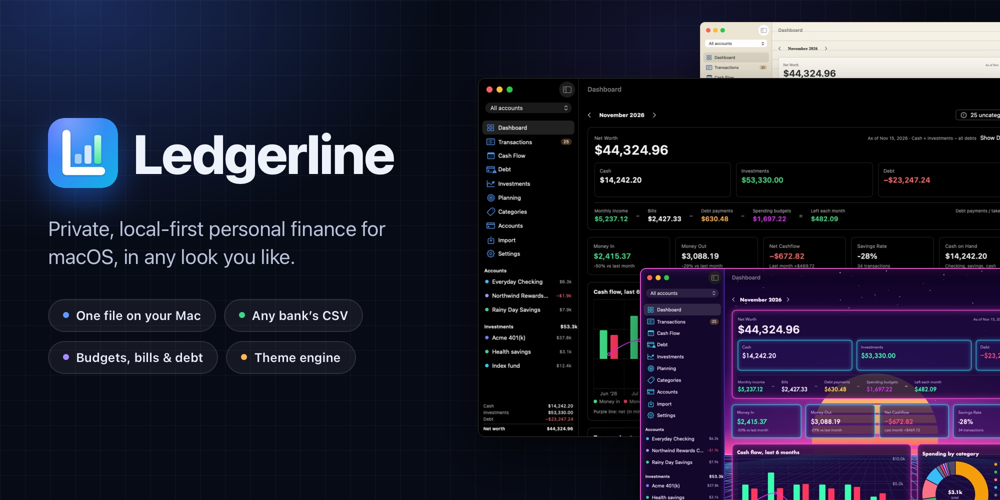
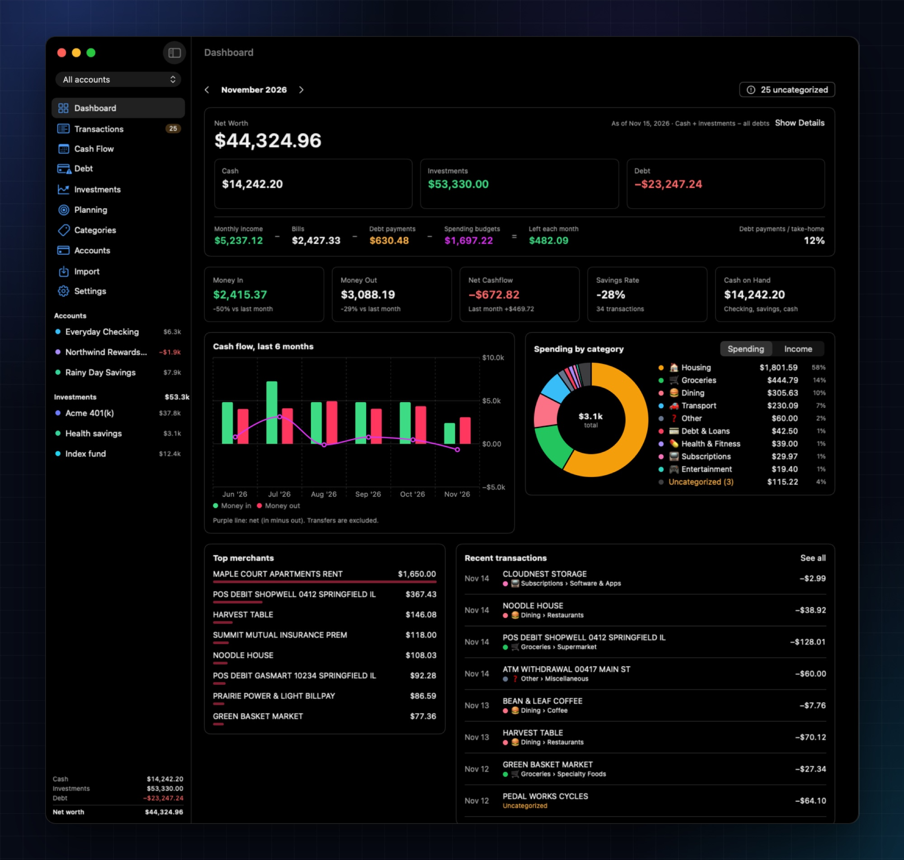
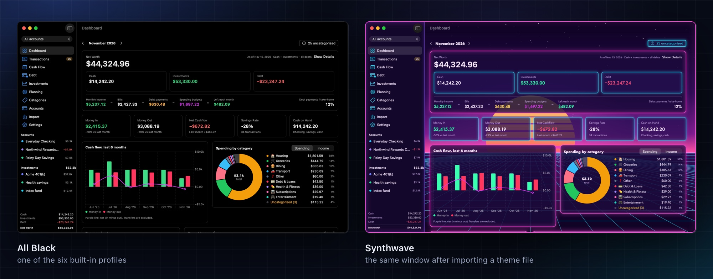
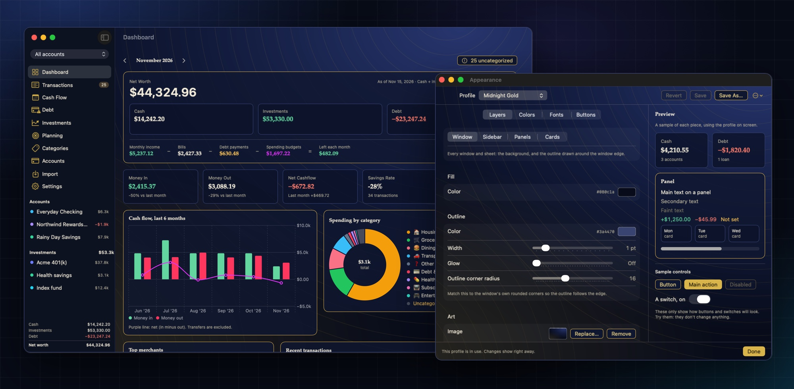
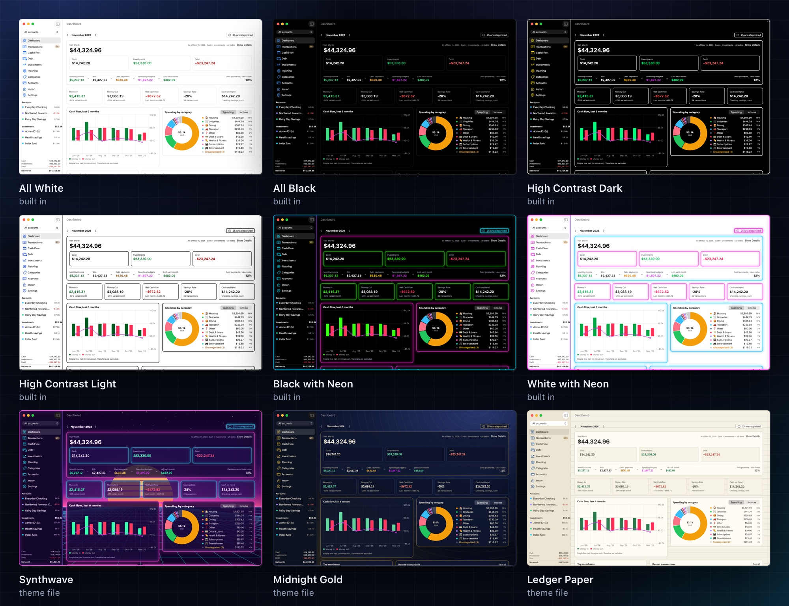
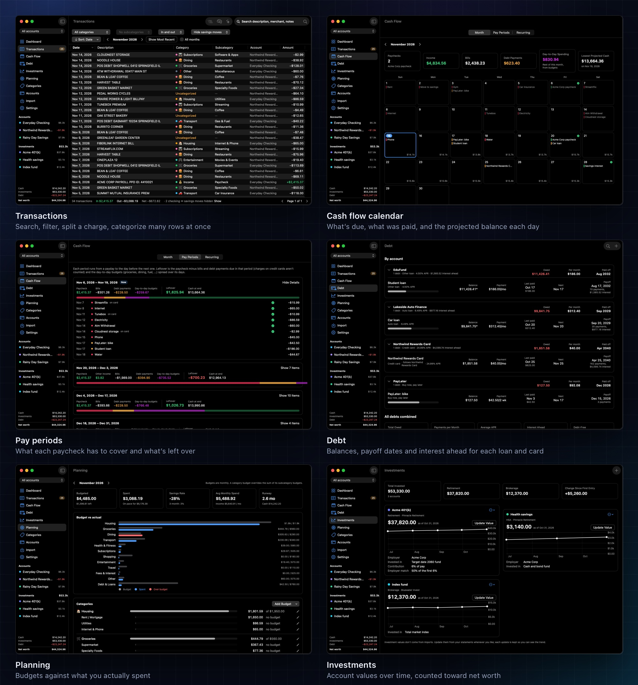

<p align="center">
  
</p>

<h1 align="center">Ledgerline</h1>

<p align="center">
  Private, local-first personal finance for macOS.<br>
  Your money stays in one file on your Mac, and the app can look any way you like.
</p>

<p align="center">
  <a href="https://github.com/zbreilly/ledgerline/releases/latest"></a>
  
  <a href="LICENSE"></a>
</p>

<p align="center">
  <a href="#download"><b>Download</b></a> ·
  <a href="#what-it-does">What it does</a> ·
  <a href="#themes">Themes</a> ·
  <a href="#more-of-the-app">More of the app</a> ·
  <a href="#features">All features</a> ·
  <a href="#build">Build it</a>
</p>

<p align="center">
  
</p>

<p align="center"><sub>Every screenshot on this page shows made-up sample data.</sub></p>

## What it does

- **Keeps everything on your Mac.** All your data is in one SQLite file that you choose. There is no account, no sync service and no server.
- **Imports any bank's CSV.** Columns are detected from the header, an overlapping export isn't counted twice, and transfers between your own accounts stay out of your spending.
- **Sorts your transactions.** Rules, a memory of the category you gave each merchant, and optional AI sorting through the `claude` or `codex` tool on your Mac.
- **Plans ahead.** Budgets, a calendar of bills and paychecks with a projected balance for each day, and what each paycheck has to cover.
- **Tracks debt and net worth.** Payoff dates and payoff plans for loans and cards, investment values you enter, and one net worth figure.
- **Looks the way you want.** The theme engine restyles every window: colors, fonts, outlines, button skins and your own art.

The full list is under [Features](#features).

## Themes

Ledgerline can look the way you want it to. Open **Ledgerline › Appearance…** to pick a profile or build your own; edits show at once in every window. The default profile, System, is the ordinary macOS look, and nothing changes until you pick or make another.

<p align="center">
  
</p>

A profile sets the colors for text, accent and status; the fonts; a fill, outline and glow for each of four layers (window, sidebar, panels, cards); two button skins; and a picture behind any layer or button.

<p align="center">
  
</p>

### Ready-made themes

Three themes are in the [`themes`](themes) folder. Download one, choose **File › Import Appearance Profile…** and pick the file. It is applied right away and added to your profiles.

| Theme | | File |
|---|---|---|
| **Synthwave** | Purple and magenta with neon outlines, over a sunset and a grid | [synthwave.ledgerlinetheme](https://github.com/zbreilly/ledgerline/raw/main/themes/synthwave.ledgerlinetheme) |
| **Midnight Gold** | Deep navy with thin gold outlines and serif headings | [midnight-gold.ledgerlinetheme](https://github.com/zbreilly/ledgerline/raw/main/themes/midnight-gold.ledgerlinetheme) |
| **Ledger Paper** | A light theme on ruled cream paper, set in serif type | [ledger-paper.ledgerlinetheme](https://github.com/zbreilly/ledgerline/raw/main/themes/ledger-paper.ledgerlinetheme) |

<p align="center">
  
</p>

### What a theme can change

- **Profiles.** Built in: All White, All Black, High Contrast Dark, High Contrast Light, Black with Neon and White with Neon. Editing a built-in makes a copy you can save under your own name.
- **Colors** for text, accent and status (money in, money owed, warnings, information).
- **Fonts** for headings and body text, from the system styles or any installed family, with a size scale.
- **Four layers**: window, sidebar, panels and cards. Each has a fill, an outline (color, width, corner radius) and a glow for a neon edge.
- **Two button skins**: standard buttons and the main action button, each with its own fill, outline and text color.
- **Art** on any layer or button, from a PNG or SVG: fill, fit, stretch, tile or frame (corners stay put while edges stretch). Drag the image into place in the editor. Buttons can have separate hover and pressed images.
- **A color picker** with a hue ring around a triangle, HSB, RGB and hex fields, opacity, an eyedropper and the theme's own colors. The same picker is used for account and category colors.
- **Share a theme** as one `.ledgerlinetheme` file that includes its art.
- **Shared themes are safe to open.** Every value is checked, and every image is decoded and re-made as a new PNG before it is stored, shown or exported, so a theme can't carry scripts, metadata or data tacked onto an image. SVGs are accepted only from your own files, must be self-contained, and are converted to PNG.
- Themes are saved per Mac, not in the database. Menus, alerts and open/save panels are drawn by macOS and only follow light or dark.

## More of the app

<p align="center">
  
</p>

## Download

Ready-made builds are on the [Releases page](../../releases): one universal app for Apple Silicon and Intel Macs, macOS 14 or later.

1. Download the zip, open it, and move Ledgerline to Applications.
2. The app is not notarized by Apple, so macOS blocks it the first time. Open it once, dismiss the warning, then go to System Settings > Privacy & Security and choose **Open Anyway**. You only need to do this once.

## Features

### Private by design

- Everything is in one SQLite file that you choose. There is no account, no sync service and no server.
- The app makes no network connections of its own. The only things that can send data anywhere are the two optional AI features below, and only when you start them: they hand text to an AI command-line tool you have installed.

### Importing

- **Any bank's CSV.** Columns are detected from the header and you can adjust them before importing. Separate debit and credit columns are handled.
- **No double counting.** Re-importing an overlapping export skips what's already there, including a purchase the bank listed once as pending and again as posted with a new date and description.
- **Transfers are recognized** (card payments, moves between your own accounts) and left out of spending reports.
- **Balances from the bank file.** If the export has a running-balance column, the account's balance is set from it.
- Drag a CSV onto the Dock icon to go straight to the import preview.

### Categorizing

- **Rules**, in priority order: contains, exact, starts with, regular expression or same merchant, with optional amount limits.
- **Merchant memory.** An uncategorized transaction takes the category you last gave that merchant.
- **Learn from My Categories** turns your categorized history into rules, and re-categorizing a transaction updates the rule for that merchant.
- **AI Sort** (optional) sends the descriptions and amounts of uncategorized transactions to the `claude` or `codex` command-line tool on your Mac, with its tools turned off. By default it may only choose from your existing categories.
- **AI Category Designer** (optional) sends your top merchants to the same tool and proposes categories. Existing categories are kept, and you choose which new ones to add.
- Categories and subcategories are yours to edit. Restoring the stock list only happens when you press the button.

### Transactions

- Search, filter by account, category, subcategory, type and transfers, sort by column, and step through months.
- **Split** one charge across several categories. Splits survive re-importing the same file.
- **Count a transaction toward another month**, for example a paycheck that lands on the 1st.
- Categorize many rows at once, and export to CSV.

### Dashboard and planning

- Cash on hand, money in and out, net cash flow, savings rate and runway, with a six-month cash-flow chart, category breakdown, top merchants and recent transactions.
- **Budgets** per category or subcategory, with budget versus actual and what's left as you edit.
- **Net worth**: cash plus investments, minus debts.

### Cash flow

- **Bills and income** on any schedule (weekly, every two weeks, monthly, quarterly, every six months, yearly or one time), found in your history or added by hand.
- **A calendar** showing what's due, what was paid and what was missed, with a projected cash balance for each day and the lowest point ahead.
- **Pay periods**: what each paycheck has to cover and what's left over, including months with three paychecks.
- Day-to-day spending from your budgets is spread across the month in the projection.

### Debt

- Loans, cards and buy-now-pay-later plans, with a balance you enter or one that follows a linked account.
- Payoff date, interest ahead and payments left for each debt.
- **Payoff plans**: minimums only, avalanche (highest rate first) or snowball (smallest balance first), with an extra amount per month.
- **Find Debts** suggests debts from the payments in your transactions.

### Investments

- Brokerage, retirement and HSA accounts with dated values you enter, change over time, and optional details such as employer match.

### Appearance

- Colors, fonts, layers, button skins and art are all yours to change. See [Themes](#themes) above.

### Menus and shortcuts

- Every action has a menu item, with shortcuts for the pages (⌘1 to ⌘9), month navigation, import, export and finding uncategorized transactions.

## How it is built

- **Rust core** (`core/`): CSV import, duplicate detection, transfer detection, rules, merchant memory, reports, and AI categorization. Shared by every front end.
- **SwiftUI app** (`apple/`): native macOS UI with Swift Charts. It talks to the core through bindings that [UniFFI](https://mozilla.github.io/uniffi-rs/) generates.

Other platforms (Windows, Linux, iOS, Android) can reuse the same core through UniFFI's Kotlin and Python bindings or a C ABI.

## Build

Requirements: Rust (stable) and the Xcode command-line tools. macOS 14 or later.

```bash
scripts/build-macos.sh
```

This produces `build.noindex/Ledgerline.app` and installs it into `/Applications` (set `LEDGERLINE_NO_INSTALL=1` to skip). Use `scripts/build-macos.sh debug` for a faster, unoptimized build.

To build the zip that goes on the Releases page:

```bash
scripts/package-macos.sh
```

This needs a [rustup](https://rustup.rs) toolchain with both Mac targets (`rustup target add aarch64-apple-darwin x86_64-apple-darwin`) and writes `dist/Ledgerline-<version>-macos-universal.zip`. It installs nothing. GitHub Actions runs the same script on every push (`.github/workflows/build.yml`) and publishes a release when a tag like `v0.1.0` is pushed. The release notes are that version's section of [CHANGELOG.md](CHANGELOG.md), so write it before tagging; the build fails without it.

## Run

```bash
open /Applications/Ledgerline.app
```

On first launch, choose **Open Existing Database…** or **Create New Database…**. To point the app at a specific file for one run:

```bash
open -n --env LEDGERLINE_DB=/path/to/ledgerline.db -a build.noindex/Ledgerline.app
```

You can also drag a bank CSV onto the Dock icon to go straight to the import preview.

## Test

```bash
cargo test
```

`core/examples/parity.rs` and `scripts/parity/node_parity.mjs` compare this core's output with the original Node app's. See `CLAUDE.md`.

## Layout

| Path | What it is |
| --- | --- |
| `core/src/csv.rs` | RFC 4180 parser, header guessing, money and date parsing |
| `core/src/import.rs` | Import preview and commit, duplicate hash, transfer regex |
| `core/src/rules.rs` | Priority-ordered categorization rules |
| `core/src/memory.rs` | Merchant memory (merchant keys) |
| `core/src/reports.rs` | Dashboard, cash flow, breakdown, planning, accounts |
| `core/src/ai.rs` | Runs the `claude` (Anthropic) or `codex` (OpenAI) command-line tool for AI Sort |
| `core/src/lib.rs` | The `Ledger` object exported to Swift |
| `apple/Ledgerline/` | SwiftUI screens |
| `apple/Ledgerline/Theme.swift` | Appearance profiles: colors, fonts, layers, art, save/import/export |
| `apple/Ledgerline/ArtSanitizer.swift` | Re-makes every theme image as a fresh PNG so shared themes can't carry hidden data or scripts |
| `apple/Ledgerline/ThemeSurfaces.swift` | Draws themed layers, buttons and window outlines |
| `apple/Ledgerline/HSVTrianglePicker.swift` | The hue-ring-and-triangle color picker |
| `apple/Ledgerline/AppearanceView.swift` | The Appearance window |
| `apple/Ledgerline/MenuCommands.swift` | The menu bar, and how menu items reach page actions |
| `apple/Generated/` | UniFFI output (generated by the build; not checked in) |

## License

Ledgerline is free software under the [GNU Affero General Public License v3.0](LICENSE) (AGPL-3.0-only). You may use, study, modify and share it. Any version you distribute, or run as a network service, must be released under the same license with its complete source code.

Copyright (c) 2026 The Ledgerline authors. Versions 0.1.0 and 0.1.1 were released under the MIT license and stay under it. Later versions are AGPL-3.0-only.

The Rust dependencies keep their own licenses (MIT, Apache-2.0, Zlib, MPL-2.0 and similar).
