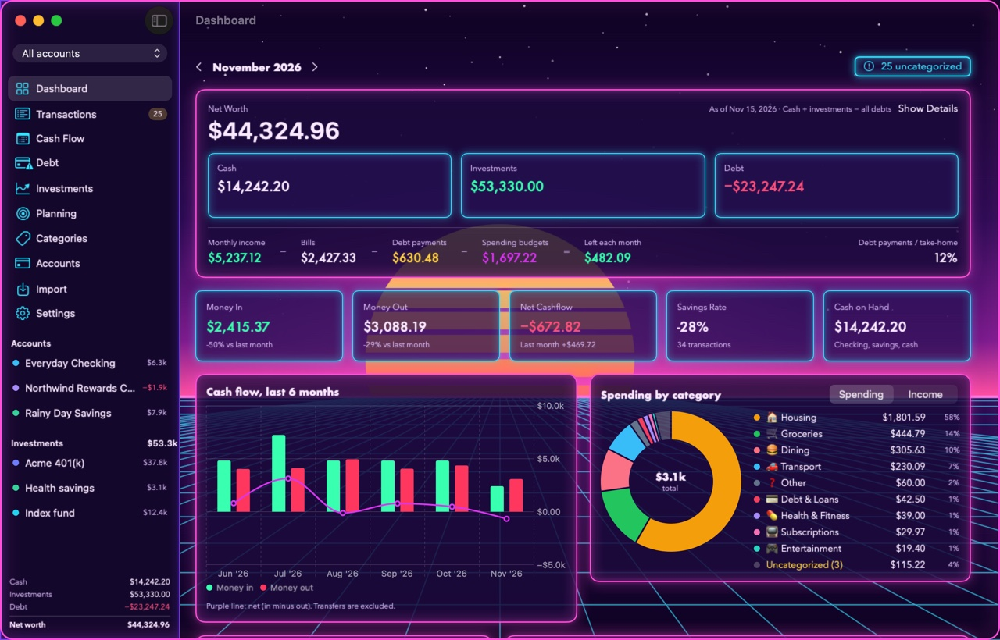
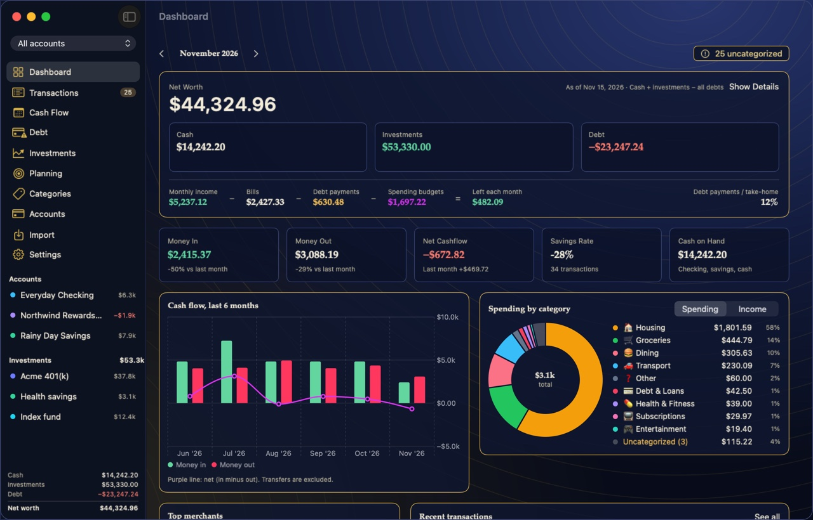
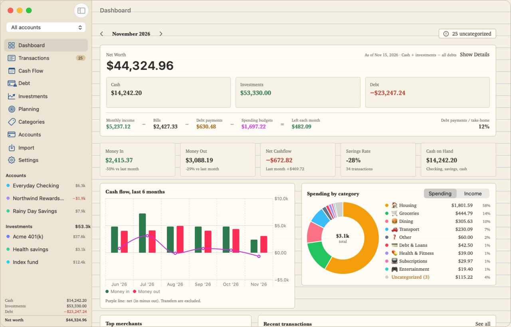

# Themes

Ready-made themes for Ledgerline. Each one is a single `.ledgerlinetheme` file with its art inside.

To use one, download the file, choose **File › Import Appearance Profile…** in Ledgerline and pick it. The theme is applied right away and added to your profiles. To go back, choose another profile under **View › Appearance**.

| Theme | Preview |
|---|---|
| **[Synthwave](synthwave.ledgerlinetheme)** Purple and magenta with neon outlines, over a sunset and a grid. Headings in Futura, text in Avenir Next. |  |
| **[Midnight Gold](midnight-gold.ledgerlinetheme)** Deep navy with thin gold outlines. Headings in Palatino. |  |
| **[Ledger Paper](ledger-paper.ledgerlinetheme)** A light theme on ruled cream paper. Headings in Baskerville, text in Charter. |  |

The fonts all come with macOS. The art was drawn for these themes and is under the same license as the rest of the project. The previews show made-up sample data.

To share your own, open **Ledgerline › Appearance…**, set it up, and choose **File › Export Appearance Profile…**.
